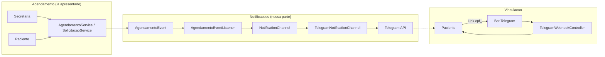
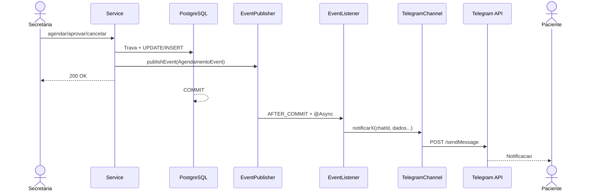
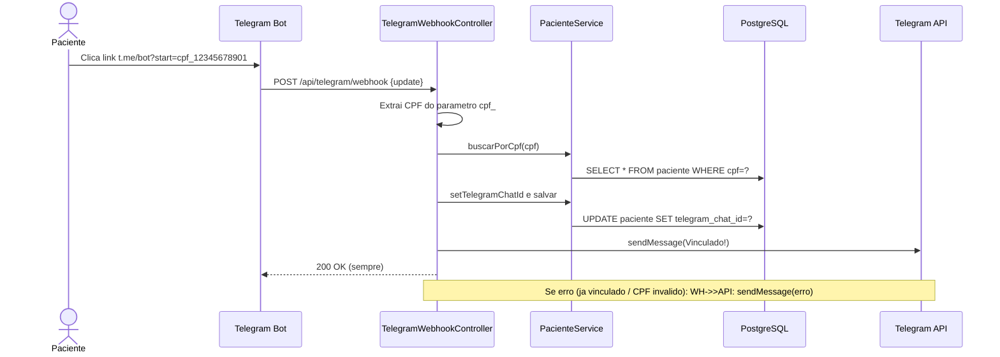

# Slides - Notificações no Telegram

---

## Problematização

**Comunicação manual**  
Paciente desinformado  
Falta de rastreabilidade

---

## Solução - Arquitetura de Notificações



**Padrões:** Event-Driven · Adapter · Strategy · Observer

---

## Fluxo: Secretária agenda / aprova / cancela → Paciente notificado



---

## Código: Publicação do Evento (AgendamentoService)

```java
// AgendamentoService.java:78, 119, 189
@Service
public class AgendamentoService {
    private final ApplicationEventPublisher eventPublisher;

    @Transactional
    public void agendar(Long horarioId, Long pacienteId, Usuario secretaria) {
        // ... trava horário, validações, INSERT agendamento ...
        
        // Publica evento PARA NOTIFICAÇÃO (pós-commit)
        eventPublisher.publishEvent(
            AgendamentoEvent.agendamentoDireto(this, paciente, horario)
        );
    }

    @Transactional
    public void cancelar(Long horarioId, String motivo, Usuario secretaria) {
        // ... validações, UPDATE histórico, libera horário ...
        
        eventPublisher.publishEvent(
            AgendamentoEvent.cancelamento(this, paciente, horario, motivo)
        );
    }
}
```

```java
// SolicitacaoService.java:119
@Transactional
public void aprovar(Long id, Usuario secretaria) {
    // ... UPDATE horario=OCUPADO, solicitação=APROVADO, INSERT agendamento ...
    
    eventPublisher.publishEvent(
        AgendamentoEvent.aprovacaoSolicitacao(this, paciente, horario)
    );
}
```

---

## Código: Evento com Dados Primitivos (sem entidades JPA)

```java
// AgendamentoEvent.java
public class AgendamentoEvent extends ApplicationEvent {
    private final Tipo tipo;
    private final Long pacienteId;
    private final String pacienteNome;
    private final String pacienteTelegramChatId;  // <-- só o ID, não a entidade
    private final Long medicoId;
    private final String medicoNome;
    private final LocalDate data;
    private final LocalTime horaInicio;
    private final String motivo;  // só cancelamento

    // Factory methods
    public static AgendamentoEvent agendamentoDireto(Object source, Paciente p, Horario h) { ... }
    public static AgendamentoEvent aprovacaoSolicitacao(Object source, Paciente p, Horario h) { ... }
    public static AgendamentoEvent cancelamento(Object source, Paciente p, Horario h, String motivo) { ... }
}
```

> **Por que dados primitivos?** Evita `LazyInitializationException` pós-commit (fora da transação Hibernate).

---

## Código: Listener Assíncrono Pós-Commit

```java
// AgendamentoEventListener.java
@Component
public class AgendamentoEventListener {

    private final NotificationService notificationService;

    @Async
    @TransactionalEventListener(phase = TransactionPhase.AFTER_COMMIT)
    public void onAgendamentoEvent(AgendamentoEvent event) {
        // 1. Validações rápidas
        if (!notificationService.getChannel().isConfigured() || !event.temChatId()) {
            return;
        }

        try {
            // 2. Delega pro canal (Strategy/Adapter)
            switch (event.getTipo()) {
                case AGENDAMENTO_DIRETO ->
                    notificationService.getChannel().notificarAgendamentoDireto(...);
                case APROVACAO_SOLICITACAO ->
                    notificationService.getChannel().notificarConfirmacao(...);
                case CANCELAMENTO ->
                    notificationService.getChannel().notificarCancelamento(...);
            }
        } catch (Exception e) {
            log.error("Falha notificação: {}", e.getMessage());
            // NÃO propaga - operação já gravada permanece válida
        }
    }
}
```

**Pontos-chave:**
- `@Async` → thread separada, resposta da API imediata
- `AFTER_COMMIT` → só envia se transação confirmou
- Try-catch → falha no Telegram **não quebra** o agendamento

---

## Código: Adapter - Canal de Notificação

```java
// NotificationChannel.java (Interface - Strategy/Adapter)
public interface NotificationChannel {
    String getIdentifier();  // "telegram"
    boolean isConfigured();
    
    void notificarConfirmacao(String chatId, String paciente, String medico, 
                              LocalDate data, LocalTime hora);
    void notificarAgendamentoDireto(String chatId, String paciente, String medico, 
                                    LocalDate data, LocalTime hora);
    void notificarCancelamento(String chatId, String paciente, String medico, 
                               LocalDate data, LocalTime hora, String motivo);
}
```

```java
// TelegramNotificationChannel.java (Implementação concreta)
@Component
public class TelegramNotificationChannel implements NotificationChannel {
    
    private final RestClient restClient;
    private final String apiUrl;  // https://api.telegram.org/bot<token>

    @Override
    public void notificarConfirmacao(String chatId, String paciente, 
                                     String medico, LocalDate data, LocalTime hora) {
        String msg = """
            ✅ <b>Consulta confirmada!</b>
            👨‍⚕️ Médico: %s
            📅 Data: %s
            🕐 Horário: %s
            👤 Paciente: %s
            """.formatted(medico, data, hora, paciente);
        
        enviarSeConfigurado(chatId, msg);
    }
    // ... demais métodos similares
}
```

> **Adapter/Strategy:** Trocar Telegram por WhatsApp/Email = nova classe implementando `NotificationChannel`, **zero mudança** nos services.

---

## Fluxo: Vinculação Paciente ↔ Telegram (Webhook)



---

## Código: Webhook Controller

```java
// TelegramWebhookController.java
@RestController
@RequestMapping("/api/telegram")
public class TelegramWebhookController {

    @PostMapping("/webhook")
    public ResponseEntity<Void> receberUpdate(@RequestBody TelegramUpdate update) {
        if (update.message() != null && update.message().text() != null) {
            processarMensagem(update.message());
        }
        return ResponseEntity.ok().build();  // Sempre 200
    }

    private void processarMensagem(TelegramMessage message) {
        String texto = message.text().trim();
        long chatId = message.chat().id();

        if (texto.startsWith("/start cpf_")) {
            String cpf = texto.substring(9);  // remove "/start cpf_"
            
            if (Cpf.valido(cpf)) {
                Paciente paciente = pacienteService.buscarPorCpf(cpf);
                
                if (paciente.getTelegramChatId() == null) {
                    paciente.setTelegramChatId(String.valueOf(chatId));
                    pacienteService.salvar(paciente);
                    telegramBotService.enviarMensagemSimples(chatId, "✅ Conta vinculada!");
                }
            }
        }
        // ... /meuid, mensagens não reconhecidas
    }
}
```

---

## Teste: Prova do Comportamento Crítico

```java
// NotificacaoAposCommitTest.java
@SpringBootTest
class NotificacaoAposCommitTest {

    @MockitoBean private NotificationChannel canal;
    @Autowired private ApplicationEventPublisher eventos;
    @Autowired private PlatformTransactionManager tm;

    @Test
    @DisplayName("Mensagem só sai DEPOIS do commit")
    void enviaSoDepoisDoCommit() {
        new TransactionTemplate(tm).executeWithoutResult(status -> {
            eventos.publishEvent(AgendamentoEvent.agendamentoDireto(...));
            // Ainda dentro da transação
            verify(canal, after(300).never()).notificarAgendamentoDireto(any());
        });
        // Pós-commit, thread @Async
        verify(canal, timeout(5000)).notificarAgendamentoDireto(...);
    }

    @Test
    @DisplayName("Rollback → NENHUMA mensagem")
    void naoEnviaQuandoHaRollback() {
        new TransactionTemplate(tm).executeWithoutResult(status -> {
            eventos.publishEvent(AgendamentoEvent.cancelamento(...));
            status.setRollbackOnly();
        });
        verify(canal, after(1000).never()).notificarCancelamento(any());
    }

    @Test
    @DisplayName("Falha no Telegram NÃO quebra operação")
    void falhaNoEnvioNaoQuebraOperacao() {
        doThrow(new RuntimeException("Telegram down"))
            .when(canal).notificarAgendamentoDireto(any());

        assertThatCode(() -> 
            new TransactionTemplate(tm).executeWithoutResult(status ->
                eventos.publishEvent(AgendamentoEvent.agendamentoDireto(...))
            )
        ).doesNotThrowAnyException();
    }
}
```

**Valida os 3 requisitos da proposta:**
1. ✅ Envio **após commit**
2. ✅ Rollback → **zero mensagens**
3. ✅ Falha no canal → **operação persiste**

---

## Resumo - Padrões Aplicados

| Padrão | Onde | Benefício |
|--------|------|-----------|
| **Event-Driven** | Services → EventPublisher → Listener | Desacoplamento temporal |
| **Adapter** | `NotificationChannel` → `TelegramNotificationChannel` | Isola API externa |
| **Strategy** | `NotificationService` usa `NotificationChannel` | Troca canal sem mudar negócio |
| **Observer** | `@EventListener` / `ApplicationEventPublisher` | Spring gerencia inscrição |
| **Circuit Breaker** | Try-catch no listener | Falha externa não derruba negócio |
| **DTOs Primitivos** | `AgendamentoEvent` | Funciona fora de transação Hibernate |

---

## Como Apresentar (sugestão)

| Slide | Conteúdo | Tempo |
|-------|----------|-------|
| 1 | Problematização | 30s |
| 2 | Arquitetura (diagrama caixas) | 45s |
| 3 | Fluxo seq. agendamento→notificação | 1min |
| 4 | Código: publicação evento (2 trechos) | 1min |
| 5 | Código: Evento (dados primitivos) | 30s |
| 6 | Código: Listener (@Async + AFTER_COMMIT) | 1min |
| 7 | Código: Adapter Channel | 45s |
| 8 | Fluxo Webhook vinculação | 45s |
| 9 | Código: Webhook Controller | 45s |
| 10 | Teste automatizado (3 cenários) | 45s |
| 11 | Tabela padrões | 30s |
