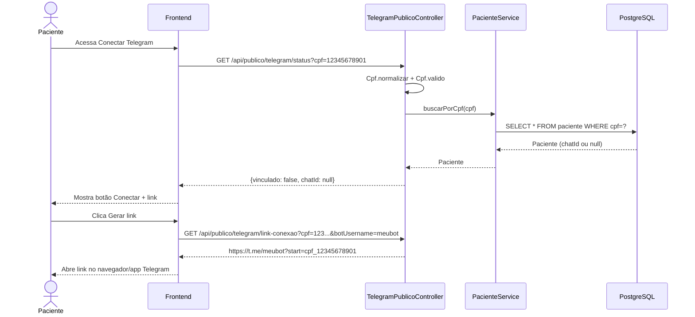
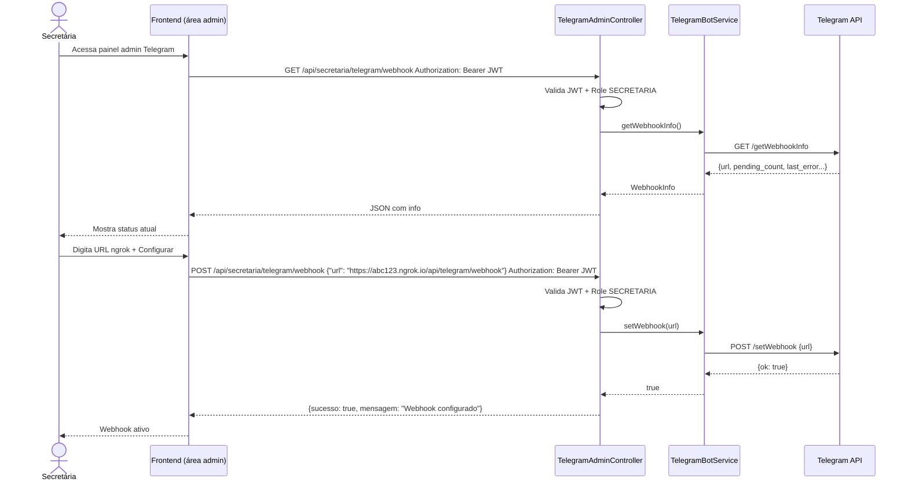
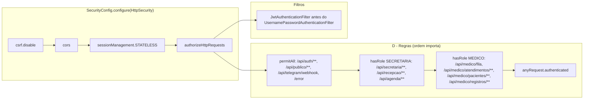

# Diagramas - Controllers Telegram & Autenticação

---

## 1. Visão Geral - Três Controllers

```mermaid
flowchart LR
    subgraph "Frontend Paciente"
        FP[Paciente acessa site]
    end

    subgraph "Frontend Secretária"
        FS[Secretária logada]
    end

    subgraph "Telegram"
        TG[Bot Telegram]
    end

    subgraph "Backend - Controllers Telegram"
        PUB[TelegramPublicoController<br/>/api/publico/telegram]
        ADM[TelegramAdminController<br/>/api/secretaria/telegram]
        WH[TelegramWebhookController<br/>/api/telegram/webhook]
    end

    subgraph "Serviços"
        PS[PacienteService]
        TBS[TelegramBotService]
    end

    FP -->|GET /status?cpf=| PUB
    FP -->|GET /link-conexao?cpf=| PUB
    PUB --> PS

    FS -->|POST /webhook (JWT)| ADM
    FS -->|GET /webhook (JWT)| ADM
    FS -->|POST /webhook/remover (JWT)| ADM
    ADM --> TBS

    TG -->|POST /webhook (JSON)| WH
    WH --> PS
    WH --> TBS
```

---

## 2. Endpoints por Controller

```mermaid
flowchart TD
    subgraph "TelegramPublicoController /api/publico/telegram"
        PUB1[GET /status cpf → {vinculado, chatId}]
        PUB2[GET /link-conexao cpf, botUsername → URL t.me/...]
    end

    subgraph "TelegramAdminController /api/secretaria/telegram"
        ADM1[POST /webhook body: {url} → configura webhook]
        ADM2[GET /webhook → info webhook atual]
        ADM3[POST /webhook/remover → remove webhook]
    end

    subgraph "TelegramWebhookController /api/telegram"
        WH1[POST /webhook recebe update do Telegram]
    end

    PUB1 -.->|usa| PS[PacienteService]
    PUB2 -.->|usa| Cpf[Cpf.util]
    ADM1 -.->|usa| TBS[TelegramBotService.setWebhook]
    ADM2 -.->|usa| TBS[TelegramBotService.getWebhookInfo]
    ADM3 -.->|usa| TBS[TelegramBotService.deleteWebhook]
    WH1 -.->|usa| PS[PacienteService.buscarPorCpf]
    WH1 -.->|usa| TBS[TelegramBotService.enviarMensagemSimples]
```

---

## 3. Fluxo: Paciente Consulta Status + Gera Link



---

## 4. Fluxo: Secretária Configura Webhook



---

## 5. Fluxo: Telegram Envia Update (Webhook)

```mermaid
sequenceDiagram
    actor Pac as Paciente
    participant TG as Telegram Bot
    participant WH as TelegramWebhookController
    participant PS as PacienteService
    participant TBS as TelegramBotService
    participant DB as PostgreSQL

    Pac->>TG: Abre link t.me/bot?start=cpf_12345678901
    TG->>WH: POST /api/telegram/webhook {update_id, message: {text: "/start cpf_123...", chat: {id: 98765}, from: {...}}}
    
    WH->>WH: processarMensagem(message)
    WH->>WH: Extrai cpf_12345678901
    WH->>WH: Cpf.valido(12345678901)
    WH->>PS: buscarPorCpf(12345678901)
    PS->>DB: SELECT * FROM paciente WHERE cpf=?
    DB-->>PS: Paciente (sem chatId)
    PS-->>WH: Paciente

    WH->>PS: paciente.setTelegramChatId(98765); salvar()
    PS->>DB: UPDATE paciente SET telegram_chat_id=98765
    DB-->>PS: OK
    PS-->>WH: Paciente atualizado

    WH->>TBS: enviarMensagemSimples(98765, Conta vinculada!)
    TBS->>TG: POST /sendMessage {chat_id: 98765, text: ...}
    TG-->>TBS: {ok: true}
    TG-->>Pac: Push notification Conta vinculada!

    WH-->>TG: 200 OK (sempre)
```

---

## 6. Matriz de Autenticação

```mermaid
flowchart TD
    subgraph "Endpoints Públicos (permitAll)"
        E1[/api/auth/**]
        E2[/api/publico/**]
        E3[/api/telegram/webhook]
        E4[/error]
    end

    subgraph "Endpoints Secretária (JWT + Role SECRETARIA)"
        S1[/api/secretaria/**]
        S2[/api/recepcao/**]
        S3[/api/agenda/**]
    end

    subgraph "Endpoints Médico (JWT + Role MEDICO)"
        M1[/api/medico/fila]
        M2[/api/medico/atendimentos/**]
        M3[/api/medico/pacientes/**]
        M4[/api/medico/registros/**]
    end

    subgraph "Controllers Telegram"
        PUB[TelegramPublicoController /api/publico/telegram]
        ADM[TelegramAdminController /api/secretaria/telegram]
        WH[TelegramWebhookController /api/telegram/webhook]
    end

    E2 --> PUB
    E3 --> WH
    S1 --> ADM

    classDef public fill:#c8e6c9,stroke:#2e7d32;
    classDef secretaria fill:#fff3e0,stroke:#ef6c00;
    classDef medico fill:#e3f2fd,stroke:#1565c0;

    class E1,E2,E3,E4 public;
    class S1,S2,S3 secretaria;
    class M1,M2,M3,M4 medico;
```

---

## 7. SecurityConfig - Regras Resumidas



---

## 8. Código: JWT Filter (resumo)

```java
// JwtAuthenticationFilter.java - intercepta requests com Bearer token
@Component
public class JwtAuthenticationFilter extends OncePerRequestFilter {

    @Override
    protected void doFilterInternal(HttpServletRequest request, 
                                     HttpServletResponse response, 
                                     FilterChain chain) {
        String authHeader = request.getHeader("Authorization");
        
        if (authHeader != null && authHeader.startsWith("Bearer ")) {
            String token = authHeader.substring(7);
            
            if (jwtService.validar(token)) {
                String username = jwtService.getUsername(token);
                UsuarioDetails user = usuarioDetailsService.loadUserByUsername(username);
                
                Authentication auth = new UsernamePasswordAuthenticationToken(
                    user, null, user.getAuthorities()  // contém ROLE_SECRETARIA ou ROLE_MEDICO
                );
                SecurityContextHolder.getContext().setAuthentication(auth);
            }
        }
        chain.doFilter(request, response);
    }
}
```

---

## 9. Tabela Resumo para Slide

| Endpoint | Controller | Auth | Quem Chama | Proteção Extra |
|----------|------------|------|------------|----------------|
| GET /api/publico/telegram/status | Publico | Nenhuma | Frontend paciente | Valida CPF |
| GET /api/publico/telegram/link-conexao | Publico | Nenhuma | Frontend paciente | Valida CPF |
| POST /api/secretaria/telegram/webhook | Admin | JWT + SECRETARIA | Frontend secretária | @AuthenticationPrincipal |
| GET /api/secretaria/telegram/webhook | Admin | JWT + SECRETARIA | Frontend secretária | @AuthenticationPrincipal |
| POST /api/secretaria/telegram/webhook/remover | Admin | JWT + SECRETARIA | Frontend secretária | @AuthenticationPrincipal |
| POST /api/telegram/webhook | Webhook | Nenhuma | Telegram Bot | Valida payload JSON + CPF |

---

## 10. Por que Webhook é Público?

```mermaid
flowchart TD
    A[Telegram Bot] -->|POST /webhook| B{SecurityConfig}
    B -->|permitAll /api/telegram/webhook| C[TelegramWebhookController]
    
    C --> D[Validações no Controller]
    D --> D1[JSON valido?]
    D --> D2[message.text existe?]
    D --> D3[/start cpf_XXXXXXXXXXX?]
    D --> D4[Cpf.valido?]
    D --> D5[Paciente existe?]
    D --> D6[Ja vinculado?]
    
    D1 -.->|Não| E[Log erro + 200 OK]
    D2 -.->|Não| E
    D3 -.->|Não| E
    D4 -.->|Não| E[Responde: CPF invalido]
    D5 -.->|Não| E[Responde: CPF não encontrado]
    D6 -.->|Sim| E[Responde: Ja vinculado / Outro chat]
    
    D6 -.->|Não| F[Vincula chatId + 200 OK]
    
    style B fill:#fff3e0,stroke:#ef6c00
    style C fill:#e3f2fd,stroke:#1565c0
```

**Razões:**
1. Telegram **não suporta** headers customizados (Authorization, API Key)
2. Segurança via **validação de payload** (CPF + formato comando)
3. Sempre retorna 200 OK → evita retry infinito do Telegram
4. Rate limit natural: 1 CPF = 1 paciente = 1 vinculação

---

## Como Apresentar (sugestão)

| Slide | Conteúdo | Tempo |
|-------|----------|-------|
| 1 | Visão geral 3 controllers | 30s |
| 2 | Endpoints por controller | 30s |
| 3 | Fluxo paciente (status + link) | 45s |
| 4 | Fluxo secretária (config webhook) | 45s |
| 5 | Fluxo webhook (recebe update) | 45s |
| 6 | Matriz de autenticação | 30s |
| 7 | SecurityConfig regras | 30s |
| 8 | Por que webhook público | 30s |
